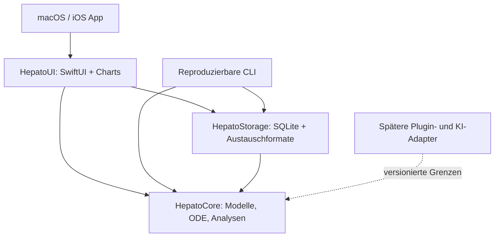

# HepatoSim Research — Architektur, Meilenstein 1

Stand: 22.10.2026. Forschungsprototyp mit synthetischen Simulations- und Patientendatensätzen sowie einer getrennten Evidenzebene aus veröffentlichten ALD-Studienaggregaten. Keine klinische Kalibrierung oder medizinisch validierte Vorhersage; kein Medizinprodukt für individuelle Entscheidungen.

## Umfang und Abhängigkeiten

Der erste ausführbare Vertical Slice simuliert einen synthetischen Leberzustand, vergleicht eine hypothetische Intervention mit einer Kontrolle, speichert den vollständigen Lauf lokal in SQLite und zeigt Zeitreihen in einer nativen macOS-Oberfläche. iOS nutzt dieselben Swift-Package-Bibliotheken. Der gebündelte, versionierte ALD-Evidenzkatalog enthält fünf überprüfte Primärstudien mit Quellen, Populationen und Endpunktarten. Studienaggregate fließen nicht automatisch in ODE-Parameter ein. Spätere Phasen haben eigene Abnahmekriterien; ein Konzept gilt nicht als implementierte Funktion.

Der Kern importiert weder SwiftUI noch Datenbank- oder Netzwerkcode. Zustände, Parameter, Szenarien, Modellversion und numerische Konfiguration werden zusammen mit Ergebnissen serialisiert. Die UI darf gespeicherte Werte nicht stillschweigend mit einer neueren Modellversion neu berechnen. Zeitintegration und Ensembleberechnung laufen außerhalb des UI-Threads; Diagramme verwenden die gespeicherten Samples. Die Evidenzansicht verwendet eigene Typen für Rohanteile, Ereigniszeitschätzungen und kontinuierliche Befunde.

## Projektstruktur

| Pfad | Verantwortung |
|---|---|
| `Package.swift` | Gemeinsame Bibliotheken, macOS-App, CLI, Tests |
| `Sources/HepatoCore` | Geprüfte Eingaben, versionierter Simulationskern, deterministische Analysen und typisierte Studienaggregate |
| `Sources/HepatoCore/Resources/ald-evidence.json` | Eingefrorener ALD-Quellenkatalog; keine individuellen Patientendaten oder kalibrierten Modellraten |
| `Sources/HepatoStorage` | SQLite-Repository, JSON/CSV, synthetische Datensätze |
| `Sources/CSQLite` | Systemmodul für Apples sqlite3 |
| `Sources/HepatoUI` | Gemeinsames Forschungs-Dashboard und Szenarioeditor |
| `Sources/HepatoSimApp` | macOS-Startpunkt |
| `Sources/HepatoCLI` | Reproduzierbarer Integrationslauf ohne UI |
| `Apps/iOS` | iPhone-App-Integration und Build-Anleitung |
| `Tests` | Numerik, Eingabegrenzen, Persistenz und Austauschformate |
| `Docs` | Modell, Datenbank, Plugins, Validierung, Meilensteine |
| `Scripts` | Wiederholbare lokale Paketierung |

## Technologiebewertung

| Entscheidung | Begründung und Grenze |
|---|---|
| Swift 6, Swift Package Manager | Ein typsicherer Kern für macOS und iOS; keine externe Laufzeit nötig |
| SwiftUI, Swift Charts; macOS 14 / iOS 17 als Minimum | Native Bedienung, dynamische Schrift, Dark/Light Mode und VoiceOver |
| SQLite über Systembibliothek | Explizites, versioniertes Schema; transaktionaler Speicher; auf beiden Plattformen verfügbar |
| Swift-native ODE-Integration | Vier Zustände benötigen zunächst keine Python-, Rust- oder C++-Brücke |
| CPU als Referenz | Metal erst nach reproduzierbarem Benchmark einschließlich Transfer- und Startkosten |
| Lokale synthetische Daten und publizierte Studienaggregate | Getrennte Simulations-/Evidenzebenen; keine Accounts, Telemetrie oder externen KI-Aufrufe im Slice |

Dateirechte und App-Sandbox begrenzen Zugriff, ersetzen aber keine Datenbankverschlüsselung. Individuelle reale Patientendaten erfordern ein eigenständiges Datenschutz- und Sicherheitskonzept. App-Sandbox und Vertriebsignatur müssen am paketierten Artefakt geprüft werden.

## Erweiterungsgrenzen

Neue biologische Modelle müssen eine eigene Modellkennung und Parameterdefinition besitzen. Ein Austausch darf nur explizit stattfinden. Klinische Scores sind aus dokumentierten Eingabewerten abgeleitete Auswertungen, keine Validierung des dynamischen Modells. KI-Ausgaben bekommen einen eigenen Typ mit Quellen, Providerkennung und Hypothesenstatus; sie dürfen keine simulierten Zustände überschreiben. Das Plugin-Konzept erlaubt auf iOS ausschließlich mit der App ausgelieferte native Implementierungen oder explizit autorisierte Serveraufrufe.
