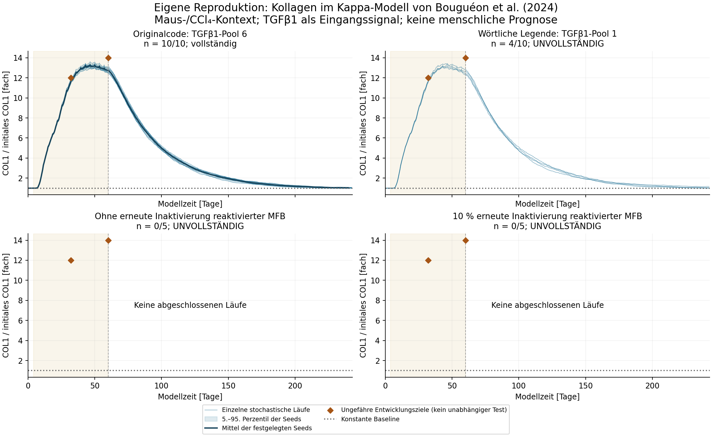
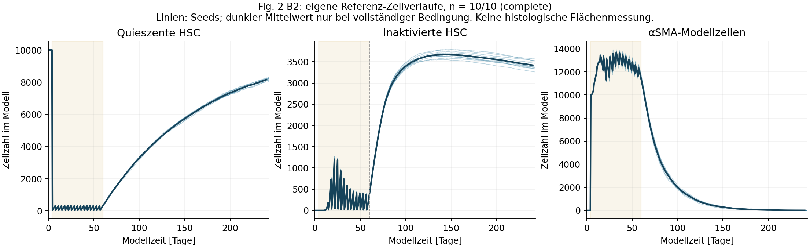

# Forschungsmeilenstein HSR-BG2024-001

Datum: 22.10.2026. **Abgeschlossener Forschungsmeilenstein mit teilweiser Publikationsreproduktion. Das vollständige geplante Versuchsprogramm wurde innerhalb des Budgets nicht erreicht.**

Forschungsfrage: Kann ein veröffentlichtes Modell experimentell beobachtete Kollagenablagerung während Leberschädigung und nach deren Ende reproduzieren und anschließend an unabhängigen Daten vorhersagen? Der aktuelle Schritt prüft zuerst die Originalimplementierung und die Voraussetzungen eines biologischen Benchmarks. Ein technischer Abbruch oder eine fehlende Datenbasis wird ausdrücklich berichtet.

## 1. Audit des bestehenden Projekts

Der [vollständige Audit](09-DemonstrationModelAudit.md) klassifiziert die vorhandenen Zustände, vier Differentialgleichungen, acht Raten, Szenarioeingriffe, numerischen Parameter und sechs abgeleiteten Größen. Der [maschinenlesbare Audit](../Research/Audit/audit-manifest.json) hält Quellen und Grenzen fest. Die bisherigen Raten wurden nicht aus biologischen Messreihen geschätzt. Zahlenbereiche im Code begrenzen zulässige Eingaben; sie sind keine experimentell belegten plausiblen Intervalle.

Das bestehende RK4-Demonstrationsmodell besitzt keine geprüfte Messabbildung seines Matrixindex auf Kollagenmasse, Hydroxyprolin oder histologische Fläche. Seine Labor- und Funktionsproxies werden daher nicht auf den neuen Messdaten-Benchmark übertragen. Die getrennt integrierten ALD-Studien liefern klinische Beobachtungen, aber keine Kalibrierung dieser ODE. Wegfall des Schädigungseingangs garantiert im Demonstrationsmodell auch keinen sofortigen Matrixrückgang.

Die 52 vorhandenen Swift-Tests wurden für den Audit erneut erfolgreich ausgeführt. Zwei Angaben des bisherigen [Prüfberichts](07-VerificationReport.md) wurden präzisiert: Der behauptete unabhängige Python-Referenzgenerator ist nicht versioniert vorhanden; vier gespeicherte Zahlen belegen lediglich numerische Regression. Der Konvergenztest betrifft isolierten exponentiellen Entzündungsabbau, keinen allgemeinen Nachweis für das gekoppelte System. Der historische Bericht bleibt mit datierter Korrektur erhalten. Die App wurde für diesen Forschungsmeilenstein nicht verändert.

## 2. Referenzmodell und Geltungsbereich

Auswahl: Bouguéon et al. (2024), *A rule-based multiscale model of hepatic stellate cell plasticity: Critical role of the inactivation loop in fibrosis progression*, [DOI 10.1371/journal.pcbi.1011858](https://doi.org/10.1371/journal.pcbi.1011858). Benanntes Reproduktionsziel: **Abbildung 2 B2/B3**, HSC-Zellzustände und Kollagen unter wiederholter Stimulation mit anschließender Erholung.

| Merkmal | Festlegung |
|---|---|
| Biologischer Kontext | CCl₄-induzierte Fibrose in Mäusen; ergänzende Parameterevidenz teilweise aus Zellkultur/anderen Spezies |
| Modellsystem | Nicht räumliche HSC-Populationen mit stochastischen Kappa-Regeln und Aktivierungszählern; zwei COL1-Token |
| Eingang | 16 TGFβ1-Pulse im Abstand 3,5 Tage, erste nominelle Schwelle Tag 4; keine CCl₄-Pharmakokinetik |
| Zeit | Bis zum Originalstopp um Tag 242,5; letzte nominelle Pulsschwelle 56,5; nominaler Beendigungsanker 60 |
| Messgröße | `COL1 tot`, Summe der beiden Kollagenpools; willkürliche Modelleinheiten, Ausgangswert 0,5; Auswertung als Vielfaches dieser Baseline |
| Zellgrößen | qHSC, iHSC und αSMA-Modellzellzahl; keine automatische Gleichsetzung mit histologischen Flächen |
| Nicht abgedeckt | Menschliche ALD, Zirrhoseheilung, gesamte Leberfunktion, klinische Laborverläufe, Dekompensation, Überleben und Medikamentendosierungen |

Modellrepository: `MBougueon/HSC_model_Kappa`, Commit `773a84e65b514b969db20c57b6bf0ba97c1d32fb`. Originalpipeline: `MBougueon/simulation_pipeline`, Commit `8b10a8dc403190a0b198918f0288b3d962ab7d40`. [Dateihashes](../Research/Reference/source-lock.json) und unveränderte Originalquellen sind enthalten.

Ausführung: offizielle KaSim-Version v4.1.3.1, Versionsausgabe `KaSim bafaeb8`, Quellcommit `bafaeb8873cb4e4afd9b22ae312dc93724cfc2fa`; x86_64-Binary auf Apple M3, 8 CPU-Kernen, 16 GiB RAM. Der [Runtime-Lock](../Research/Reference/runtime-lock.json) dokumentiert SHA256 und Bezugsquelle. Die im Artikel genannte Bezeichnung „Kappa 4.2.12“ konnte keiner entsprechenden offiziellen KaSim-Version eindeutig zugeordnet werden. Eine Identität mit der Autorenumgebung wird nicht behauptet.

Die Original-Python-Pipeline ist wegen einer fehlenden `utils.py` und eines Syntaxfehlers nicht unverändert ausführbar. Deshalb ruft ein kleiner eigener Adapter denselben originalen KaSim-Interpreter direkt auf. Er ändert weder Modellregeln noch Solver. Im Projekt existiert bislang eine Plugin-Spezifikation, aber keine ausführbare Plugin-Laufzeit; der Adapter bleibt ein vom UI unabhängiges Forschungs-CLI.

## 3. Vorab definierter Test und Quellenkonflikte

Die [Spezifikation 1.1.0](../Research/Reference/benchmark-v1.1.0.json) wurde vor Ausführung eingefroren, einschließlich Seeds, Messzeitpunkten, Datenaufteilung, Fehlermaßen und Abbruchregeln. Sie ergänzt die erhaltene Version 1.0 ausschließlich um ein längeres Einzelzeitlimit und eine offizielle Speicherverwaltungsoption. Keine Parameter wurden an anschließend sichtbare Ergebnisse angepasst.

Vier Bedingungen: unveränderter Repository-Default mit Seeds 101–110; wörtliche Inputinterpretation der Abbildungslegende mit denselben zehn Seeds; Originalvariante ohne erneute Inaktivierung mit Seeds 101–105; Inaktivierungs-Verzweigungsgewicht 10 % mit Seeds 101–105. Zusätzlich ein Seed-Replay und ein feineres Ausgaberaster. Budget: 32 Läufe, maximal zwei Prozesse, 900 Sekunden je Lauf, insgesamt 3.600 Sekunden, höchstens 500 MB; keine Optimierungsläufe.

Vorab festgelegte Auswertungstage: 0, 32, 60, 90 und 240. Verwendet wird der letzte tatsächlich aufgezeichnete Wert am oder vor dem jeweiligen Tag; die ausgewählte Zeit wird mitgespeichert. Kein Extrapolieren. Abweichungen durch nicht exakt auf der Zielzeit liegende Ausgaben gehören zum Bericht und werden nicht stillschweigend interpoliert.

Wesentliche ungelöste Quellenkonflikte:

- Die Legende nennt 10.000 TGFβ1-Moleküle je Zelle; der Repository-Default ergibt 60.000. Deshalb zwei getrennte vorab definierte Bedingungen.
- Reaktivierte-MFB-Verdopplungszeit im Code etwa 4,43 Tage gegenüber 8,86 Tagen in der Supplementtabelle.
- Zwei Kollagenregeln verwenden eine andere Zeitumrechnung als parallele Regeln. Zusätzlich erzeugen zwei Zehnerfaktoren bei maximalen Zählern ein Produktionsverhältnis von 100:1 gegenüber beschriebenen 10:1. Diese Befunde wurden nicht eigenmächtig korrigiert.
- Exakte Originalseeds, numerische Autorenkurven und eine zweifelsfrei identifizierte Autorenruntime fehlen.

Der [Quellenbericht](../Research/Reference/selection-and-data.md) enthält Fundstellen und Interpretation. Die [Variantenprüfung](../Research/Reference/variant-audit.md) zeigt: Geänderte erneute Inaktivierung verändert zugleich den komplementären Apoptose-/Seneszenzweg bei unveränderter Summenrate. „Ohne erneute Inaktivierung“ bedeutet nicht „ohne jede HSC-Inaktivierung“. Gleiche Seeds bei verändertem Regelkatalog garantieren keine biologische Ereignispaarung.

## 4. Tatsächlich ausgeführte Ergebnisse

<!-- RESULTS_START -->
Abschließender Analysesnapshot: `2026-10-22T12:27:07.806811+00:00`. Die Serie ist beendet. **14 von 32 geplanten Jobs sind vollständig abgeschlossen.** 2 wurden durch das Zeitbudget beendet, 16 wegen erschöpften Budgets nicht gestartet. Das Gesamtbudget wurde nicht verlängert. Ein abgebrochener Lauf ist kein biologisches Negativergebnis.

Der frühere v1-Erstversuch endete nach 180 Sekunden mit gespeicherten Werten bis Modelltag 23. Im v1.1-Gesamtbudget wurden `caption_literal-105` nach 356,84 Sekunden bei Modelltag 134,5 und `caption_literal-106` nach 8,68 Sekunden bei Modelltag 7 beendet. Ihre Zeitlimits wurden durch das verbleibende Gesamtbudget begrenzt; dies ist kein Nachweis, dass diese Bedingungen prinzipiell nicht ausführbar wären. Der letzte Start mit nur wenigen Sekunden Restbudget zeigt zusätzlich eine Schwäche der Laufplanung. Alle Teildateien bleiben erhalten und gehen nicht in vollständige biologische Verlaufsauswertungen ein.

| Bedingung | Vollständige primäre Seeds | Status |
|---|---:|---|
| `repository_default` | 10/10 | complete |
| `caption_literal` | 4/10 | incomplete |
| `without_reinactivation` | 0/5 | incomplete |
| `reinactivation_10pct` | 0/5 | incomplete |

Die folgenden Kennzahlen verwenden alle zehn vorab festgelegten Default-Seeds 101–110. Wiederholung und Rasterkontrolle werden nicht als zusätzliche Ensemblemitglieder gezählt. Für unvollständige Alternativbedingungen werden nur erhaltene Einzelläufe gezeigt; keine selektiven Ensemble- oder Mechanismusvergleiche.

### Kollagen im vollständigen Default-Ensemble

| Modelltag | n (Seeds) | Mittel [fach Baseline] | SD | Empirisches 5.–95. Perzentil | MCSE des Mittels |
|---:|---:|---:|---:|---:|---:|
| 0 | 10 | 1,000 | 0,000 | 1,000–1,000 | 0,000 |
| 32 | 10 | 11,563 | 0,124 | 11,407–11,750 | 0,039 |
| 60 | 10 | 12,739 | 0,170 | 12,535–13,003 | 0,054 |
| 90 | 10 | 6,368 | 0,204 | 6,044–6,599 | 0,065 |
| 240 | 10 | 1,036 | 0,029 | 1,000–1,074 | 0,009 |

Größte Differenz zwischen angeforderter und tatsächlich ausgewählter Default-Messzeit: 0,000 Tage. Die Normalisierung verwendet den fixierten Ausgangswert COL1 = 0,5 A.U. SD, Perzentile und MCSE beschreiben die stochastischen Modellläufe, **keine Mess-, Parameter- oder klinische Prognoseunsicherheit**.

| Vorgegebene Veränderung | Mittlere Änderung [fach Baseline] | SD der gepaarten Änderungen |
|---|---:|---:|
| Tag 60 minus Tag 0 | 11,739 | 0,170 |
| Tag 90 minus Tag 60 | -6,370 | 0,199 |
| Tag 240 minus Tag 60 | -11,703 | 0,171 |

**Richtungsreproduktion:** Im vollständigen Default-Ensemble treten der Anstieg während der Schädigung und der anschließende Kollagenrückgang auf. Das reproduziert den qualitativen Verlauf des benannten Fig.-2-Ergebnisses innerhalb des ausgeführten Modells. Es belegt weder die exakte Gleichheit mit nicht verfügbaren Autorenkurven noch unabhängige biologische Vorhersagegüte.

### Abweichung von den publizierten Entwicklungszusammenfassungen

| Vergleich | MAE [fach Baseline] | RMSE [fach Baseline] |
|---|---:|---:|
| Default-Ensemblemittel | 0,849 | 0,944 |
| Konstante Baseline 1 | 12,000 | 12,042 |

Bei Tag 32 liegt das Default-Mittel um 0,437, bei Tag 60 um 1,261 unter dem ungefähren Entwicklungsziel. Die Ziele sind 12 beziehungsweise 14, keine exakten Rohmessungen. Der Fehler wird am vorab festgelegten Zeitpunkt bewertet; ein günstigerer Kurvenhöchstwert wurde nicht nachträglich ausgewählt. Keine Parameter wurden nachjustiert. Es ist kein quantitativer Bestehensstatus definiert.

### Stochastische und technische Zuverlässigkeit

| Modelltag | Mittel Seeds 106–110 minus Mittel 101–105 | MCSE dieser Differenz |
|---:|---:|---:|
| 32 | 0,138 | 0,067 |
| 60 | 0,018 | 0,114 |
| 90 | 0,062 | 0,135 |
| 240 | -0,011 | 0,019 |

Der Vergleich zweier Fünfergruppen quantifiziert endliche Monte-Carlo-Streuung, beweist aber weder Verteilungskonvergenz noch Stabilität seltener Ereignisse. Die kleine Streuung bei festen Parametern beseitigt keine Unsicherheit über Parameter, Messabbildung oder widersprüchliche Quellen.

| Technische Kontrolle | Tatsächlicher Status |
|---|---|
| Vollständiger Seed-Replay | not_performed |
| 0,5-/0,25-Tage-Ausgaberaster | not_performed |
| Gemeinsames v1-/v1.1-Präfix | match; 53 numerische Zeilen bis Tag 23 exakt gleich |

Alle in die Auswertung aufgenommenen Läufe haben endliche, zeitlich geordnete Ausgaben, vollständige Beobachtung bis mindestens Tag 240 und geprüfte Quellen-, Argument- und Tracezuordnung. Der kleinste erfasste Nichtzeitwert beträgt 0,000; es wurden keine negativen Ausgaben abgeschnitten. Dies ist keine Aussage über alle internen Ereignisse oder beliebige andere Parameter.

Die nicht ausgeführten Replay-/Rasterkontrollen bleiben offen. Dass sie in der Warteschlange nach sämtlichen Primärbedingungen standen, erwies sich unter diesem Budget als ungünstige Priorisierung. Der nächste kleine technische Lauf sollte diese beiden Kontrollen zuerst ausführen; eine neue Spezifikation und ein eigenes Budget sind dafür erforderlich. Das hier dokumentierte Präfix reicht nur bis Tag 23 und ersetzt die vollständigen Kontrollen nicht.

**Softwareprüfungen:** 74 Tests des Forschungsadapters und der Analyse bestanden. Zusätzlich wurde der Figurenfall „unvollständige Kontrolle, vollständige Alternative“ auf vollständige Legende geprüft. Zwei im Review entdeckte falsche Positivfälle wurden korrigiert: abweichende Startargumente trotz passender Metadaten und ein unvollständiges Raster trotz übereinstimmender Endpunkte. Ein unverändert kopiertes Ergebnisarchiv bleibt auswertbar. Die originalen Modellregeln und die laufende Serie wurden dabei nicht geändert.

**Vergleich mit der eigenen Implementierung:** Der eigene Python-Code organisiert und prüft die unveränderte Originalsimulation. Er ist keine unabhängige Neuimplementierung der Biologie. Der Swift-Demonstrationskern wurde separat auditiert und getestet; mangels Kollagen-Messabbildung erhält er keinen scheinbar vergleichbaren Fehlerwert.

[Maschinenlesbare Auswertung mit Einzelwerten und Provenienz](../Research/Reference/analysis/benchmark-v1.1.json) · [Testprotokoll](../Research/Reference/analysis/software-tests.txt)

<!-- RESULTS_END -->

## 5. Messdaten-Benchmark und Identifizierbarkeit

Die ursprünglichen Modellautoren nutzten Kisseleva et al. (2012), [DOI 10.1073/pnas.1201840109](https://doi.org/10.1073/pnas.1201840109), zur Kalibrierung und Modellauswahl. Die im Modellartikel genannten ungefähr 12-fachen und 14-fachen Kollagenwerte nach einem beziehungsweise zwei Monaten sind deshalb **Entwicklungszusammenfassungen**, keine unabhängigen Testdaten. Für diese extrahierten Textziele sind keine verifizierten Rohwerte, Streuungen oder kollagenspezifischen Stichprobengrößen verfügbar. Es wurden keine Einzelmessungen erfunden und keine Abbildungskurven digitalisiert.

Der konstante Baselineverlauf mit Faktor 1 ist ein einfacher, parameterfreier Vergleich. MAE und RMSE werden für die beiden Entwicklungsziele berechnet; sie sind deskriptiv und kein Beleg einer externen Vorhersageleistung. Eine quantitative Bestehensgrenze wäre ohne geklärtes Messmodell und Messunsicherheit nicht sachlich begründet. Deshalb gibt es weder eine erfundene „95-%-Genauigkeit“ noch einen nach Ergebnislage verschobenen Grenzwert.

Die konstante Baseline ist ein Nullmodell, kein anspruchsvoller Prognosevergleich. Ein Vorteil gegenüber ihr würde die zusätzliche Komplexität des mechanistischen Modells noch nicht rechtfertigen. Ein späterer echter Vorhersagebenchmark sollte vorab beispielsweise einen einfachen stückweisen Anstiegs-/Abbauverlauf auf denselben Entwicklungsdaten anpassen und auf derselben unabhängigen Studie prüfen. Ein solcher nachträglicher Fit wird hier nicht als Bestandteil des eingefrorenen Tests ergänzt.

Bereits von den Autoren untersuchte Fig.-4-Daten, DMN-/TAA-/Hochfettvergleiche und menschliche NASH-Transkriptome werden nicht als neu unabhängige Kollagenprüfung verwendet. Als spätere externe Datenquelle wurde Hofer et al. (2025), [DOI 10.1002/ueg2.12643](https://doi.org/10.1002/ueg2.12643), geprüft: Tabelle 1 enthält Sirius-Red-CPA nach 12 Wochen CCl₄/TAA und nach 7/14 Tagen Rückzug. Die publizierten Gruppen poolen jedoch die beiden Toxine; individuelle Daten sind auf Anfrage verfügbar. Unabhängige Vorhersageprüfung setzt toxinbezogene Stratifizierung, ein vorab festgelegtes Eingangs-/Messmodell und getrennte Entwicklungsdaten voraus. Opferungsgruppen sind keine individuellen Längsverläufe. IQR ist kein Konfidenzintervall des Medians.

Die [parameterbezogene Quellenprüfung](../Research/Reference/parameter-identifiability.md) präzisiert eine zu grobe Formulierung der eingefrorenen Spezifikation: **43 Tabellenpositionen sind nicht 43 freie Fitparameter.** Die Tabelle kennzeichnet 22 Werte als empirisch geschätzt, neun als berechnet, zehn mit bloßem PMID-Verweis und zwei ohne Referenz. Acht der 22 empirisch bezeichneten Werte sind im Default algebraisch gekoppelt; darunter verbleiben 14 separat gesetzte Grundgrößen, neun davon für Kollagen. Diese Codezählung ist kein Identifizierbarkeitsrang. Der Artikel nennt zudem weitere Zell-/Regressionsbeobachtungen und Modellannahmen; seine ursprüngliche Kalibrierung beruhte nicht nur auf den beiden Fold-Changes. Welche einzelnen Parameter mit einem konkret definierten Datensatz identifizierbar wären, wurde hier nicht formal untersucht.

Die beiden ungefähren Kollagenziele allein belegen keine eindeutige gemeinsame Schätzung der veränderlichen Synthese-, Abbau- und Umbaueingaben. Ohne geeignete Daten und Messfehler wurden keine neue Parameterschätzung und kein Parameterposterior erzeugt. Die Varianten sind keine Stichprobe aus statistisch begründeter Parameterunsicherheit. Mehrere gut passende Parametersätze zu behaupten, ohne sie tatsächlich zu schätzen und zu prüfen, wäre ebenso unbelegt wie ein angeblich eindeutiger Satz. Der unveränderte Wortlaut des eingefrorenen Protokolls bleibt als historische Aussage erhalten; die vorliegende Korrektur verändert weder Rechenbedingungen noch Auswertungsgrenzen.

## 6. Getrennte Unsicherheiten

| Unsicherheit | Was geprüft wird / was offenbleibt |
|---|---|
| Stochastische Prozessstreuung | Tatsächliche Seeds; Mittel, Stichproben-SD, empirische 5./95. Perzentile nur bei vollständigen Bedingungen |
| Endliche Anzahl Wiederholungen | MCSE = SD/√n und festgelegter Vergleich der beiden Fünfergruppen; zehn Läufe belegen keine Konvergenz seltener Verteilungsenden |
| Numerik/Implementierung | Quellen-/Tracehashes, Argumente und Ausgabeprüfungen durchgeführt; vollständiger Seed-Replay und Ausgaberastervergleich wegen Budgets nicht durchgeführt. Keine RK4-Schrittweitenprüfung für dieses ereignisbasierte Modell. |
| Parameterunsicherheit | Nicht statistisch quantifiziert; geeignete Messreihen fehlen |
| Struktur-/Inputunsicherheit | Default vollständig; nur vier Einzelläufe der Legendenvariante, Mechanismusvarianten nicht ausgeführt. Dokumentierte Source-Konflikte; keine vollständige Modellraumprüfung. |
| Mess-/Stichprobenfehler | Für die ungefähren Entwicklungsziele unbekannt; keine erfundenen Fehlerbalken |
| Übertragbarkeit | Andere Spezies, Schädigungsursachen und klinische Endpunkte nicht geprüft |

## 7. Behandlungshypothesen und nächster Schritt

Eine robuste Therapiehypothese wird aus diesem Meilenstein nicht allein wegen eines simulierten Kollagenrückgangs abgeleitet. Zunächst müssen die Quellenkonflikte, vollständige technische Reproduktion und externe Messabbildung geklärt werden. Die wichtigste nächste Information sind die originale Autorenkonfiguration mit numerischen Referenzkurven und toxinbezogene Kollagendaten einer getrennten Studie. Eine Kontaktaufnahme wurde nicht vorgenommen.

Experimentell unterscheidbare Anschlussfrage: Ändert die Verteilung von erneuter Inaktivierung gegenüber Apoptose/Seneszenz bei vergleichbarer gesamter Abgangsrate den verbleibenden HSC-Pool und den späteren Kollagenrückgang? Messbar wären gleichzeitig histologisches Kollagen und per Lineage-Tracing getrennte HSC-Zustände nach festgelegtem Schädigungsende. Geeignete Kontrollen müssten die Schädigung, den Gesamtabgang und das Messverfahren vergleichbar halten. Zeitpunktwahl und Stichprobengröße erfordern ein eigenes, vor Datensichtung festgelegtes Experiment und eine Varianz-/Powerplanung.

Mögliche Gegenbefunde: Kollagenrückgang ohne entsprechende Änderung des HSC-Schicksals; veränderte Gesamtabgangsrate; kein reproduzierbarer Effekt außerhalb einer einzelnen Stimulusinterpretation; dominanter Matrixabbau durch im Modell fehlende Prozesse. Richtung und Stärke dieser Hypothese sind damit noch nicht als robust bestätigt. Ein Parameterwert wird keinem konkreten Medikament zugeordnet; menschliche Dosierungen oder individuelle Empfehlungen werden nicht abgeleitet.

## 8. Reproduzierbarkeit und Nachweisgrenzen

Die [Ausführungsanleitung](../Research/Reference/README.md) enthält getestete Analyse-/Testbefehle und den Befehl für eine neue, getrennte Rechenserie. Originale CSVs, Laufmanifeste und Umgebungsangaben liegen unter `Research/Reference/results/`. Der vollständige erste Timeoutlauf bleibt erhalten. Ein gemeinsames numerisches Präfix kann geprüft werden; es ersetzt keinen vollständigen Replay. Die alte v1-Runnerfassung wurde nicht separat als Quellstand archiviert, ihr Hash und sämtliche tatsächlich verwendeten KaSim-Argumente sind erhalten. Die v1.1-Runnerfassung ist enthalten und gegen ihren aufgezeichneten Hash prüfbar.

Der lokale Goose-/DeepSeek-Auftrag wurde tatsächlich zweimal begrenzt versucht; beide Aufrufe endeten ohne verwertbare Antwort. [Aufruf- und Prüfbericht](../Research/Reference/local-goose-audit.md). Keine lokale Modellantwort wurde als wissenschaftlicher Beleg verwendet.

Die Originalmodelle/-pipeline haben AGPL-Lizenz, KaSim eine separate LGPL-Lizenz, der Artikel CC BY 4.0. Für eigenen HepatoSim-Code wurde hier keine neue Projektlizenz vergeben. Es erfolgten keine Veröffentlichung, kostenpflichtige Buchung oder Verarbeitung personenbezogener Gesundheitsdaten.

| Nachweisebene | Geltungsbereich |
|---|---|
| Software-Verifikation | Automatisierte Tests und konkret dokumentierte Laufprüfungen; keine pauschale Fehlerfreiheit |
| Publikationsreproduktion | Benanntes Fig.-2-Ziel; Richtungs-/Zahlenvergleich nur im tatsächlich ausgeführten Umfang, Quellenkonflikte offen |
| Unabhängige biologische Daten | Nicht durchgeführt: kein qualifizierter unabhängiger Datensatz in diesem Benchmark |
| Übertragbarkeit auf Menschen | Nicht geprüft; Maus-/CCl₄-Modell ist kein ALD-Humanmodell |
| Klinische Einsatzfähigkeit | Nicht nachgewiesen; keine individuellen Therapieentscheidungen |
